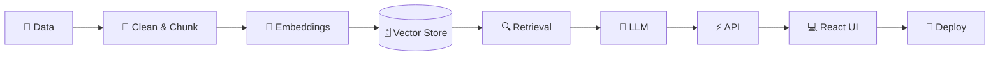
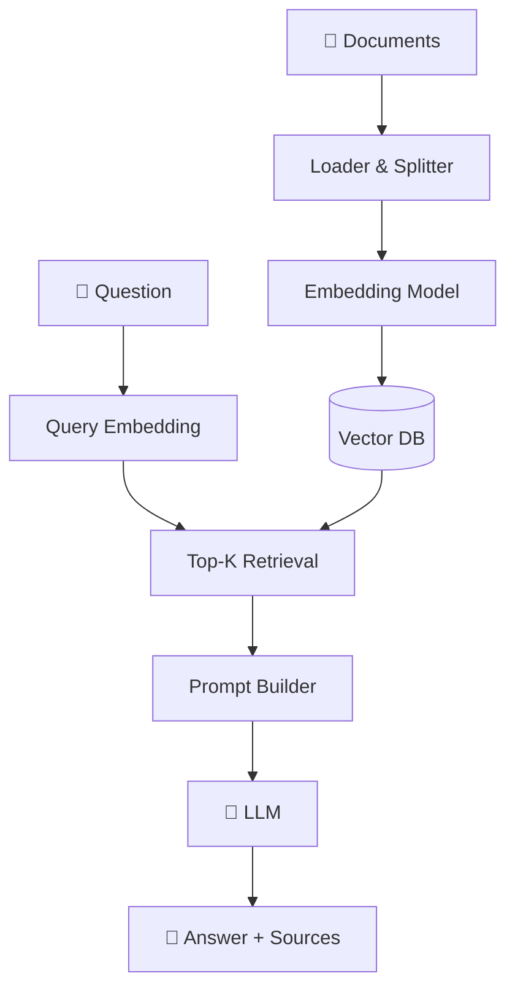

  
  
  

  
  
  
  
  

  
  
  

---

## 🪞 About Me

<table>
<tr>
<td width="60%" valign="top">

I'm an **AI/ML Engineer** who builds intelligent, production-minded applications — from **Retrieval-Augmented Generation (RAG) pipelines** and **LLM-powered assistants** to the full-stack products that put them in users' hands.

My strength is the whole path: **data → embeddings → retrieval → LLM → API → UI → deployment**. I pair that AI focus with solid full-stack skills in **React, Node.js, Django, Python, MongoDB and MySQL**, so ideas become shippable products rather than notebooks.

Right now I'm going deeper into **agentic workflows, local LLMs and MCP integrations**.

</td>
<td width="40%" valign="top">

| 🧾 Quick Facts | |
|---|---|
| 👤 **Name** | Momin Samir Ahemad |
| 🎯 **Role** | AI/ML Engineer |
| 📍 **Location** | India |
| 💬 **Languages** | Python · JS · Java · C · SQL |
| 🧠 **AI Focus** | RAG · LLM Apps · Agents |
| 🤝 **Open to** | Jobs · Freelance · Open Source |

</td>
</tr>
</table>

---

## 🧠 Tech Stack

<table>
<tr>
<td width="22%"><b>💻 Languages</b></td>
<td></td>
</tr>
<tr>
<td><b>🤖 AI / ML & Data</b></td>
<td></td>
</tr>
<tr>
<td><b>✨ GenAI & LLM</b></td>
<td>

</td>
</tr>
<tr>
<td><b>🎨 Frontend</b></td>
<td></td>
</tr>
<tr>
<td><b>⚙️ Backend & DB</b></td>
<td></td>
</tr>
<tr>
<td><b>☁️ DevOps & Tools</b></td>
<td></td>
</tr>
</table>

---

## 🤖 AI / ML Expertise

| Domain | Level | Details |
|:--|:--|:--|
| **RAG & LLM Apps** | `████████░░` 80% | Ingestion, chunking, embeddings, vector search, grounded generation |
| **Generative AI** | `████████░░` 80% | Applied GenAI for dev workflows · IBM specialization |
| **Prompt Engineering** | `████████░░` 80% | Structured prompts, context control, fewer hallucinations |
| **Data Analytics** | `████████░░` 80% | Data-driven decisions, data science foundations |
| **Cloud & Deployment** | `████████░░` 80% | Docker, Vercel, Netlify, Render |
| **Machine Learning** | `██████░░░░` 60% | Supervised learning, evaluation, scikit-learn |
| **AI Agents & Automation** | `██████░░░░` 60% | LangChain, n8n, Ollama workflows |
| **MCP Servers** | `██████░░░░` 60% | Model Context Protocol integrations |

### 🔄 My AI Engineering Workflow

---

## 🚀 Featured Projects

### ⭐ Flagship — RAG Chatbot

<table>
<tr>
<td>

#### 🧠 RAG Chatbot — Chat With Your Documents

A **Retrieval-Augmented Generation chatbot**: upload documents (PDF, DOCX, TXT) and ask questions in natural language. It retrieves the most relevant passages from your own knowledge base and generates **grounded answers with source references** — reducing hallucinations.

| Aspect | Details |
|:--|:--|
| **Retrieval** | Chunking → embeddings → FAISS / ChromaDB → top-K semantic search |
| **Generation** | Context-grounded prompts with source citations |
| **Features** | Multi-document upload · chat memory · streaming · source attribution |
| **Privacy** | Runs fully local with Ollama — documents stay on your machine |
| **Architecture** | Ingestion pipeline + retrieval service + chat UI behind a REST API |
| **Roadmap** | Hybrid search (BM25 + vectors) · re-ranking · RAG evaluation · auth |

</td>
</tr>
</table>

### 🌐 Full Stack Projects

<table>
<tr>
<td width="50%" valign="top">

**✈️ Flight Management System (Django)**

Flight scheduling, passenger booking, ticketing, auth and an admin dashboard.

`Django` `Python` `Bootstrap` `SQLite/MySQL`

Multi-role (Admin · Staff · Passenger), optimized ORM queries, CSRF & session security.

[🔗 Repository](https://github.com/Samirmomin2202/flight-management-systempp)

</td>
<td width="50%" valign="top">

**✈️ Flight Management System (MERN)**

Flight search, booking, role-based access and booking management over REST APIs.

`React` `Node.js` `Express` `MongoDB` `JWT`

JWT authentication & authorization with a responsive booking UI.

[🔗 Repository](https://github.com/Samirmomin2202/flight-managment)

</td>
</tr>
<tr>
<td width="50%" valign="top">

**💻 CodeThon**

Coding practice platform with challenges, progress tracking and user auth.

`React` `Node.js` `Express` `MongoDB`

Multi-user platform with real-time challenge updates.

[🔗 Repository](https://github.com/Samirmomin2202/codethom)

</td>
<td width="50%" valign="top">

**💼 MERN Project**

Full-stack CRUD app with responsive UI, REST APIs and protected routes.

`React` `Node.js` `Express` `MongoDB` `JWT`

Modular architecture, reusable foundation for future products.

[🔗 Repository](https://github.com/Samirmomin2202/mern)

</td>
</tr>
<tr>
<td width="50%" valign="top">

**📚 Django Project**

Django app covering secure auth, CRUD and RESTful architecture.

`Django` `Python` `Bootstrap` `SQLite/MySQL`

Follows Django best practices for scalable, maintainable code.

[🔗 Repository](https://github.com/Samirmomin2202/djano)

</td>
<td width="50%" valign="top">

**➕ More coming soon**

Advanced RAG, agentic workflows and MCP-powered tools are in progress.

`LangChain` `Ollama` `MCP`

[🔗 All repositories](https://github.com/Samirmomin2202?tab=repositories)

</td>
</tr>
</table>

---

## 💼 Experience

**AI/ML & Full Stack Developer** — *Independent / Project-Based* · `2024 — Present`

- 🧠 Built a **RAG chatbot** with document ingestion, embeddings, vector search and grounded LLM responses
- 🤖 Explored automation and agents using **LangChain, n8n and Ollama** (including local LLMs)
- 🎨 Designed responsive frontends with React, Tailwind CSS and Bootstrap
- ⚙️ Built secure REST APIs with Node.js, Express, Django and FastAPI
- 🔐 Implemented authentication, role-based access control and database design (MongoDB, MySQL, SQLite)
- ☁️ Deployed apps on Docker, Vercel, Netlify and Render

---

## 🏆 Achievements & Certifications

<table>
<tr>
<td align="center" width="33%">

**Google**

 

</td>
<td align="center" width="34%">

**IBM**

 
 

</td>
<td align="center" width="33%">

**UC Davis**

</td>
</tr>
</table>

---

## 🗺️ AI/ML Learning Roadmap

| Area | Status |
|:--|:--:|
| Python, Data Analysis, Pandas & NumPy | ✅ Done |
| Generative AI Fundamentals (IBM) | ✅ Done |
| RAG Pipelines & Vector Databases | ✅ Built |
| LangChain & Agentic Workflows | 🔄 In Progress |
| Local LLMs with Ollama | 🔄 In Progress |
| MCP Servers & Tool Use | 🔄 In Progress |
| RAG Evaluation & Re-ranking | 🔜 Next |
| Fine-tuning (LoRA / PEFT) | 🔜 Next |
| MLOps & Model Serving | 🔜 Next |

---

## 📊 GitHub Analytics

  

**Contribution Graph**

  

**Contribution Snake**

---

## 🔭 Current Focus

<table>
<tr>
<td width="33%" valign="top">

**📚 Learning**
- Advanced RAG (hybrid search, re-ranking, evaluation)
- LangChain & agentic workflows
- Fine-tuning & local LLM optimization

</td>
<td width="33%" valign="top">

**🛠️ Building**
- RAG chatbot & document Q&A
- AI automation tools
- Full-stack apps (MERN & Django)

</td>
<td width="33%" valign="top">

**🔬 Exploring**
- n8n workflow automation
- Ollama & local LLMs
- MCP servers

</td>
</tr>
</table>

---

## 📫 Connect With Me

  

*"Clean code, grounded AI, and continuous learning — that's the craft."*

